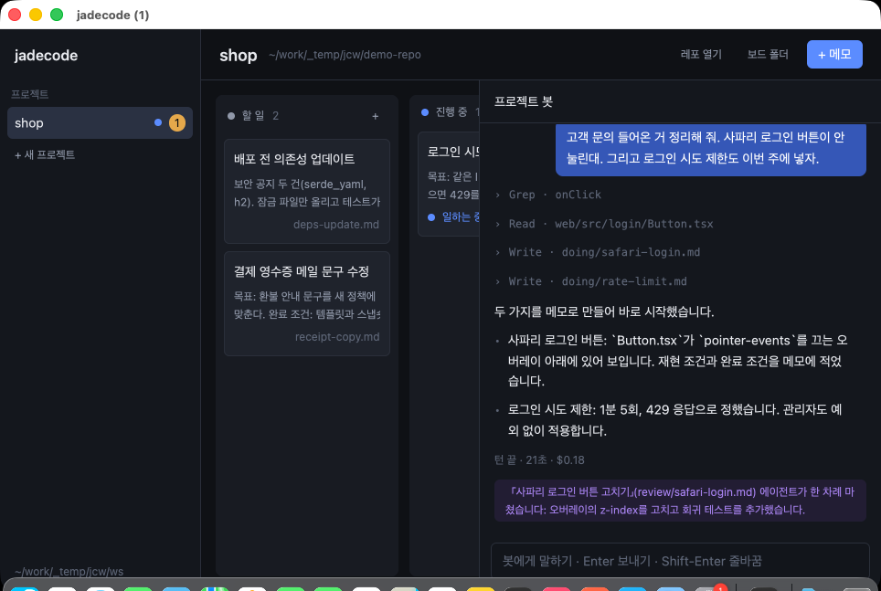

# jadecode

프로젝트마다 봇과 대화하고, 할 일은 칸반의 **md 메모**로 남기고, 메모는 Claude Code가 전용 브랜치에서 처리한다.
채팅 봇(바깥 루프)과 코딩 에이전트(안쪽 루프)를 한 창에서 잇는 것이 전부다.



## 어떻게 동작하나

```text
<워크스페이스>/                 기본 ~/jc/work
  <프로젝트>/
    project.toml               name, repo(코드 레포 경로)
    todo/  doing/  review/  done/     ← 칸반 열 = 폴더
      safari-login.md          ← 메모 = 작업 하나. 내용이 곧 맥락
  .jadecode/<프로젝트>/         세션 id·대화 기록·워크트리(사람이 볼 필요 없음)
```

1. **프로젝트 봇과 대화한다.** 프로젝트마다 대화가 하나 있다(Claude 프로젝트처럼). 봇은 레포를 읽을 수 있고,
   일을 맡길 때는 보드 폴더에 md 메모를 쓴다. 봇은 코드를 직접 고치지 않는다.
2. **메모가 `doing/`에 들어가면 시작한다.** 앱이 레포에 브랜치 `jc/<메모 이름>`과 전용 워크트리를 열고,
   메모 내용을 첫 메시지로 Claude Code를 실행한다. 사람의 작업 폴더는 건드리지 않는다.
3. **턴이 끝나면 `review/`로 옮긴다.** 메모를 열어 에이전트에게 더 말하면 다시 `doing/`으로 가서 같은 세션을 잇는다.
   "PR 만들기"는 에이전트에게 push와 Draft PR을 부탁하는 말이다.
4. **`done/`으로 옮기면 끝.** 커밋하지 않은 변경이 없으면 워크트리를 정리한다(브랜치는 남는다).
5. 끝난 소식은 봇의 다음 턴 앞에 `[보드 소식]`으로 붙는다. 봇이 따로 깨어나지는 않는다.

메모는 그냥 파일이므로 편집기·Finder·`mv`로 고치거나 옮겨도 된다. 앱은 1초 안에 반영한다.
칸반 타일을 끌어서 열을 옮길 수도 있다.

### 실행 방식

- 턴마다 `claude -p --output-format stream-json`을 새로 띄운다. 첫 턴은 `--session-id`, 이후는 `--resume`이다.
  상주 프로세스가 없으므로 앱을 다시 켜도 대화가 이어진다(앱이 꺼질 때 돌던 메모는 `review/`로 옮겨 둔다).
- 봇: 보드 폴더에서 `--permission-mode acceptEdits`, 읽기 도구와 `mv`·`git log` 같은 몇 개 명령만 허용한다.
- 메모 작업: 워크트리에서 `--permission-mode bypassPermissions`(묻지 않고 일한다). `project.toml`의
  `permission_mode`로 바꿀 수 있다. `model`도 같은 곳에서 정한다.
- 사용자 자신의 Claude Code 설정(CLAUDE.md, MCP 등)은 그대로 쓴다.

## 설치

### macOS: 경고를 매번 겪지 않는 방법 (권장)

| 방법 | Gatekeeper 경고 | 비고 |
|---|---|---|
| **Homebrew** `brew install --cask jadewisemann/jadecode/jadecode` | **없음** | quarantine 이 안 붙는다. 이후 `brew upgrade` |
| `curl \| sh` 설치 | **없음** | curl 로 받으면 quarantine 이 안 붙는다 |
| `jadecode update` | **없음** | 한 번 설치한 뒤부터는 자동 업데이트 |
| 브라우저로 DMG 다운로드 | 있음 | 브라우저가 quarantine 을 붙인다 |

브라우저 DMG 는 macOS 가 "인터넷에서 받은 파일"로 표시하기 때문에 매번 걸린다.
**Homebrew 나 `curl` 로 설치하면 그 표시가 붙지 않아 매번 겪지 않는다.**
Apple Developer 인증서(연 $99)로 서명·공증하면 브라우저 설치도 경고가 없어진다.

### macOS (Apple Silicon) — DMG

1. [Releases](../../releases) 에서 `jadecode-*-macos-aarch64.dmg` 를 내려받아 엽니다.
2. **jadecode.app** 을 **Applications** 폴더로 끌어다 놓습니다.
3. Applications 에서 jadecode.app 을 엽니다.

**서명이 ad-hoc(자체 서명)이라 Apple Developer 인증서 공증이 없습니다.** 그래서 macOS가
"jadecode.app이 손상되었습니다" 또는 "확인되지 않은 개발자"라고 막을 수 있습니다.

한 번에 고치기(권장):

```sh
curl -fsSL https://raw.githubusercontent.com/jadewisemann/jadecode/main/tools/fix-macos.sh | sh
```

이 스크립트가 격리 표시를 지우고 ad-hoc 서명을 다시 붙입니다.

수동으로 하려면:

```sh
xattr -dr com.apple.quarantine /Applications/jadecode.app
codesign --force --deep --sign - /Applications/jadecode.app
open /Applications/jadecode.app
```

Finder에서 우클릭 → 열기도 됩니다.

워크스페이스가 없으면 앱이 `~/jc/work`를 만들어 씁니다. 앱 번들 안에 명령줄 도구 `jadecode`도 들어 있습니다.

### 한 줄 (전 플랫폼)

```sh
curl -fsSL https://raw.githubusercontent.com/jadewisemann/jadecode/main/install.sh | sh
```

하는 일: 최신 릴리즈 내려받기 → **체크섬 검증** → `~/.local/bin`에 바이너리 →
macOS면 `/Applications/jadecode.app` 설치 + quarantine 해제 → `~/jc/work` 폴더 생성.

옵션(환경변수):

```sh
JADECODE_VERSION=v0.1.1-alpha   # 특정 태그
JADECODE_PREFIX=$HOME/bin       # 바이너리 위치
JADECODE_WS=$HOME/jc/proj       # 워크스페이스 위치
JADECODE_NO_APP=1               # macOS 앱 설치 건너뛰기
JADECODE_NO_WS=1                # 워크스페이스 생성 건너뛰기
curl -fsSL .../install.sh | JADECODE_VERSION=v0.1.1-alpha sh
```

### 직접 내려받기

```sh
tar -xzf jadecode-*-<플랫폼>.tar.gz
cd jadecode-*-<플랫폼>
./install.sh            # 아카이브 안의 설치 스크립트
```

지원: `macos-aarch64`(Apple Silicon), `linux-x86_64`. 체크섬(`.sha256`)이 함께 올라간다.
Intel Mac·ARM 리눅스는 아직 빌드가 없다(소스 빌드만).

### macOS: Gatekeeper

이 빌드는 **코드서명·공증이 없다**(Apple Developer 인증서 필요). 설치 스크립트가 격리 표시를
지우지만, 직접 내려받았다면 다음을 한 번 실행한다:

```sh
xattr -dr com.apple.quarantine /Applications/jadecode.app
```

또는 Finder에서 우클릭 → 열기, 또는 시스템 설정 → 개인정보 보호 및 보안 → "그래도 열기".

## 쓰기

```sh
open /Applications/jadecode.app       # 또는 jadecode-client [워크스페이스]
```

앱에서 **새 프로젝트** → 이름과 코드 레포 폴더를 고른다 → 오른쪽 봇에게 할 일을 말한다.
단축키: `⌘N` 새 메모, `⇧⌘N` 새 프로젝트, `⌘K` 입력칸, `Esc` 메모 닫기, `⌘R` 새로고침.

터미널에서도 같은 보드를 다룬다.

```sh
jadecode ls                                   # 프로젝트 목록
jadecode ls shop                              # 보드
jadecode new shop --repo ~/code/shop          # 프로젝트 만들기
echo "목표: …" | jadecode memo shop "제목"     # 할 일 메모(본문은 표준 입력). --doing이면 바로 시작
jadecode mv shop safari-login done
jadecode update                               # 최신 릴리즈로 업데이트
```

`claude`가 설치·로그인돼 있어야 한다. 다른 실행 파일을 쓰려면 `JADECODE_CLAUDE=/path/to/claude`.

## 개발

```sh
cargo test --workspace                        # 코어 테스트(가짜 claude로 메모 한 바퀴)
cargo build -p jc-client --features ui        # 앱(GPUI)
IS_SANDBOX=1 cargo test -p jc-core --test live -- --ignored --nocapture   # 진짜 Claude Code로 끝까지(과금)
```

```text
crates/jc-core       워크스페이스·보드(md)·대화 기록·워크트리·claude 실행·엔진(화면 없이 시험)
crates/jc-client     GPUI 앱: 프로젝트 목록 · 칸반 · 봇 대화 / 메모 작업
crates/jadecode-cli  jadecode 명령(ls/new/memo/mv/update)
tools/               앱 번들·DMG·설치 스크립트, 스크린샷용 데모 데이터
```

스크린샷은 `claude/**` 브랜치에 push하면 macOS 러너가 찍어서 `docs/screenshots/latest/`에 커밋한다.

